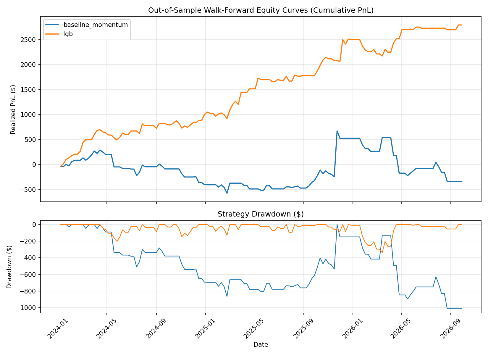
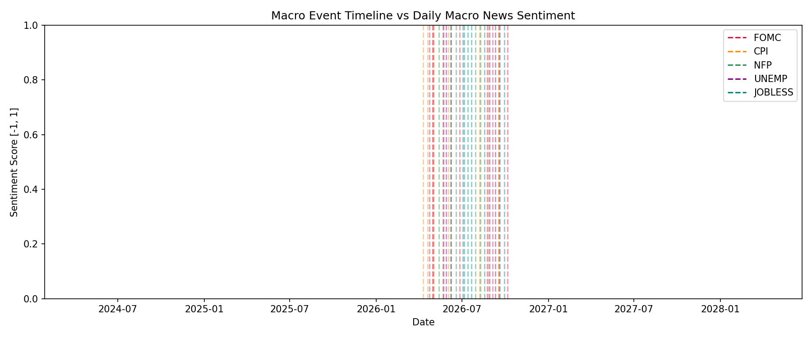
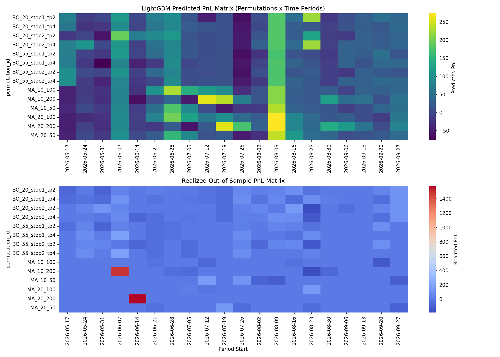

# Strategy Selection Model: Out-of-Sample Evaluation Report

## 1. Executive Summary & Methodology
We evaluate a walk-forward parameter permutation selector utilizing LightGBM with purged and embargoed validation splits. The backtest assumes a starting capital of $100,000.

## 2. Performance Comparison Table (Top 1 Permutation Selected)

| strategy          |   Max_DD_Pct |   Profit_Factor |   Samples |   Sharpe |   Sharpe_CI_High |   Sharpe_CI_Low |   Sortino |   Total_PnL |   Total_Trades |   Win_Rate |
|:------------------|-------------:|----------------:|----------:|---------:|-----------------:|----------------:|----------:|------------:|---------------:|-----------:|
| baseline_momentum |    -1.00559  |        0.899021 |       143 | -0.16095 |         0.824203 |       -1.68535  | -0.217643 |    -339.333 |            108 |   0.216783 |
| lgb               |    -0.329266 |        2.60017  |       143 |  1.9668  |         2.87921  |        0.985233 |  5.23268  |    2792.42  |            143 |   0.363636 |

## 3. Figures & Charts
### Equity Curves and Drawdowns

### Macro vs Sentiment Timeline

### Prediction Heatmap Matrix

## 4. Key Limitations & Risk Disclaimers
1. **Simulated Trades:** All trades are simulated based on backtesting strategy families (MA Crossover, Breakout) on historical yfinance data. No real brokerage logs were used.
2. **Statistical Significance:** The out-of-sample period is limited (approx. 143 weekly samples). Bootstrap confidence intervals are provided in the table above to indicate Sharpe Ratio variability.
3. **Selection Bias:** Metrics reflect the performance of the single 'Top-Selected' permutation per period as predicted by the model out-of-sample.
